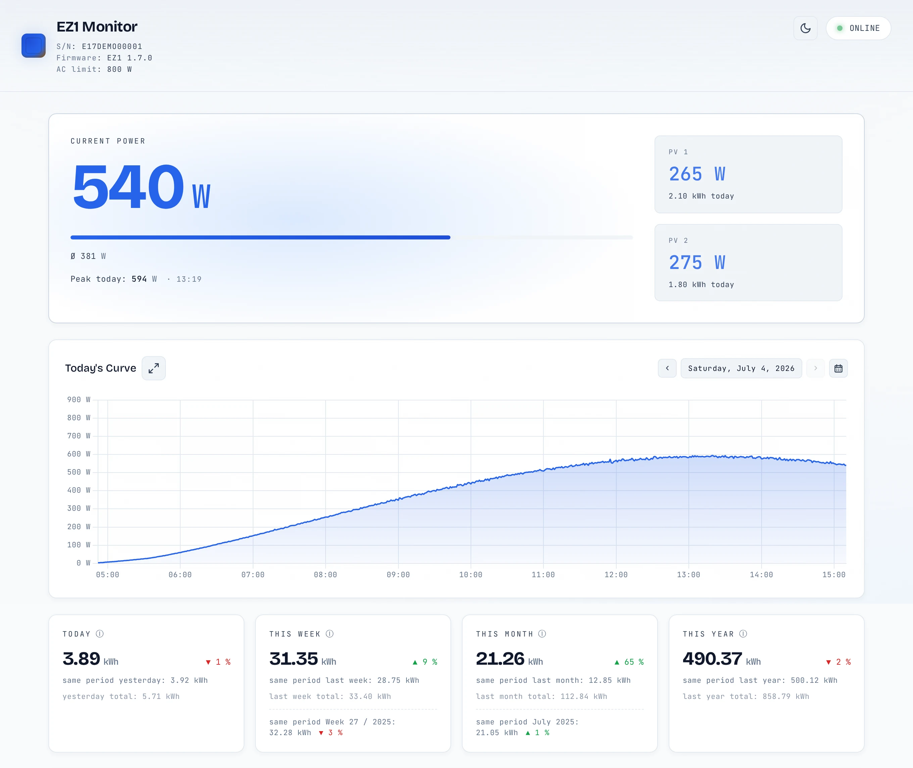
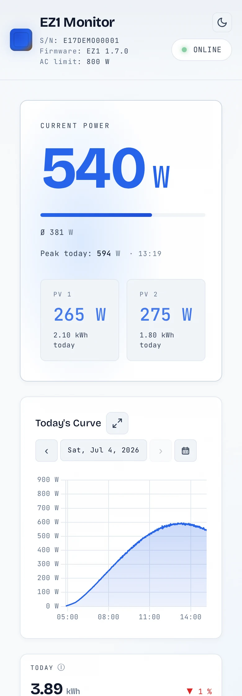
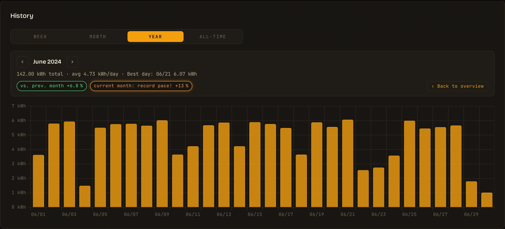
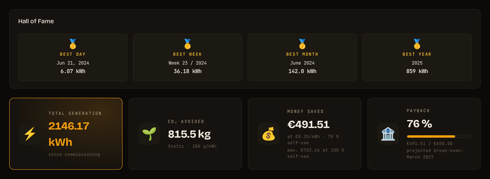
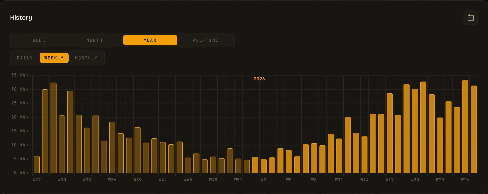
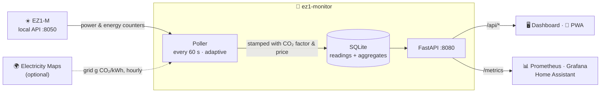

<div align="center">


# EZ1 Monitor

**A lean, self-hosted dashboard for the APsystems EZ1-M microinverter.**
Live power, every day's curve, fair comparisons and long-term records —
straight from the inverter's local API. No cloud, no account, no telemetry.

[](https://github.com/TehcSimon/ez1-monitor/actions/workflows/build-and-push.yml)
[](./LICENSE)
[](https://www.python.org/)
[](https://github.com/TehcSimon/ez1-monitor/pkgs/container/ez1-monitor)
[](#install-paths)
[](#install-paths)

</div>

---

<p align="center">
  <picture>
    <source media="(prefers-color-scheme: dark)" srcset="docs/screenshots/dashboard-dark.webp">
    
  </picture>
  <br><i>Live power, today's curve and calendar-aligned comparisons — <a href="docs/screenshots/full-dark.webp">see the whole dashboard</a>.</i>
</p>

## Why

The EZ1-M has a local HTTP API, but on its own it only knows *right now*
and *today*. EZ1 Monitor polls it, keeps every reading in SQLite and turns
them into the dashboard a balcony-plant owner actually wants: how today
compares to yesterday *at the same time*, whether this is a record week,
what the plant has saved so far and when it will have paid for itself.

Everything runs in one small container on your own hardware — a NAS, an
Unraid box, a Raspberry Pi. Nothing leaves your network unless you opt in
to live grid CO₂ data.

## What you get

<picture>
  <source media="(prefers-color-scheme: dark)" srcset="docs/screenshots/mobile-dark.webp">
  
</picture>

- ⚡ **Live view.** Total and per-input power, today's peak with its time
  and the average while producing — refreshed every 10 s while the sun is up.
- 📈 **Every day, browsable.** Today's curve plus a day picker for every
  recorded day in the retention window — or jump there from a history bar.
- ⚖️ **Fair comparisons.** Today vs. yesterday until the same clock time;
  week, month and year vs. the same point of the previous period, plus
  year-over-year.
- 🔍 **History drill-down.** Week, month, year (daily · weekly · monthly)
  and all-time. Click a bar to open that week or month with totals, best day
  and comparison pills — including a *record pace* check against your best
  period.
- 🏆 **Hall of Fame.** All-time best day, week, month and year, with a
  subtle glow while a record is fresh.
- 💶 **Savings & payback.** Realistic money saved (self-consumption share,
  feed-in tariff, tariff history) and a payback card with the projected
  break-even month.
- 🌱 **CO₂ avoided.** Static factor or live grid intensity from
  Electricity Maps, stamped onto every reading.
- 🚦 **Smart status.** Tells dusk from a real outage — no false alarms at
  night — and polls 10× slower while the inverter sleeps.
- 📊 **Prometheus `/metrics`** for Grafana, Home Assistant & co.
- 📱 **PWA, themes, two languages.** Installable on iOS and Android, light
  and dark theme, English and German.
- 🔒 **Self-contained.** All assets self-hosted (no CDN, no Google Fonts),
  non-root and UID-agnostic image for Docker, Kubernetes and OpenShift.

<br clear="right">

### A closer look

<table>
  <tr>
    <td width="50%"></td>
    <td width="50%"></td>
  </tr>
  <tr>
    <td><sub><b>Drill-down.</b> Any week or month as daily bars — compared with the previous period, last year, and whether the running period is on record pace.</sub></td>
    <td><sub><b>Records & lifetime.</b> All-time bests, total energy, CO₂ avoided, realistic savings and payback progress.</sub></td>
  </tr>
  <tr>
    <td colspan="2"></td>
  </tr>
  <tr>
    <td colspan="2"><sub><b>The year at a glance.</b> 52 weekly bars across the year boundary — click one to drill into that week.</sub></td>
  </tr>
</table>

<sub>All screenshots show synthetic demo data — see [Development → Screenshots](#screenshots).</sub>

## Quickstart

**You need** an EZ1-M on your network with a fixed IP (DHCP reservation)
and its **local API switched on**: in the AP EasyPower app, set the
inverter's *Local Mode* to **Continuous**. Check that it answers:

```bash
curl http://<EZ1-IP>:8050/getDeviceInfo
```

Then start the monitor:

```bash
docker run -d --name ez1-monitor --restart unless-stopped \
  -p 8080:8080 -v ez1-data:/data \
  -e INVERTER_IP=<EZ1-IP> \
  -e TZ=Europe/Berlin \
  ghcr.io/tehcsimon/ez1-monitor:latest
```

Open `http://<host>:8080`. `INVERTER_IP` is required — the container exits
without it. Set `TZ` to your timezone: it decides where days, weeks and
months begin (the default is UTC).

### Install paths

| | How |
|---|---|
| **Docker** | The command above. Multi-arch image (`amd64`, `arm64`) for NAS, mini PC or Raspberry Pi. |
| **Docker Compose** | Clone the repo, set `INVERTER_IP` and friends in [`docker-compose.yml`](docker-compose.yml), then `docker compose up -d`. |
| **Unraid** | One click: add `https://github.com/TehcSimon/ez1-monitor` under *Apps → Settings → Template Repositories* and install **ez1-monitor** — or set it up by hand, see below. |
| **Kubernetes / OpenShift** | UID-agnostic non-root image, works under OpenShift's restricted SCC. Snippet below. |

<details>
<summary><b>Unraid by hand</b></summary>

1. Docker tab → **Add Container**
2. Repository: `ghcr.io/tehcsimon/ez1-monitor:latest`
3. Network Type: Bridge, Port `8080:8080`
4. Path: `/mnt/user/appdata/ez1-monitor` → `/data`
5. Variables: `INVERTER_IP` = your EZ1-M's IP, `TZ` = your timezone
6. Apply

</details>

<details>
<summary><b>Kubernetes pod snippet</b></summary>

```yaml
spec:
  securityContext:
    runAsNonRoot: true
    fsGroup: 0           # required for /data volume write access
  containers:
    - name: ez1-monitor
      image: ghcr.io/tehcsimon/ez1-monitor:latest
      env:
        - { name: INVERTER_IP, value: "192.168.1.100" }
        - { name: TZ, value: "Europe/Berlin" }
      volumeMounts:
        - { name: data, mountPath: /data }
      ports:
        - { containerPort: 8080 }
      livenessProbe:
        httpGet: { path: /health, port: 8080 }
```

</details>

## How it works



- **Every reading is stamped** with the CO₂ factor and electricity price
  active at that moment. A tariff change only affects new production, and
  with Electricity Maps the cleaner noon grid counts exactly when your
  panels produce.
- **Raw readings are pruned** after `RETENTION_DAYS` (default: two years).
  Daily, monthly and yearly aggregates are kept forever — they feed the
  all-time view, the Hall of Fame and drill-downs into any past week or month.
- **Comparisons are calendar-aligned.** Tuesday 09:30 is compared with last
  Tuesday 09:30, the 12th of a month with the 12th of the previous one —
  never a half day against a full one.

## Configuration

All configuration is done via environment variables.

| Variable | Default | What it does |
|---|---|---|
| `INVERTER_IP` | **required** | IP address or hostname of the EZ1-M |
| `TZ` | `Etc/UTC` | IANA timezone (e.g. `Europe/Berlin`) — where days, weeks and months begin |
| `INVERTER_PORT` | `8050` | Port of the inverter's local API |
| `POLL_INTERVAL` | `60` | Seconds between polls; 10× slower (max. 5 min) while the inverter is offline |
| `PRICE_PER_KWH` | `0.35` | Your electricity price per kWh, stamped on every reading — update it when your tariff changes |
| `CURRENCY` | `EUR` | ISO 4217 code for money formatting (`EUR`, `USD`, `CHF`, …) |
| `SELF_CONSUMPTION_PCT` | `100` | Share (%) of production you use yourself; only affects money and payback |
| `FEED_IN_TARIFF` | `0` | Compensation per fed-in kWh, same currency (often `0` for balcony plants) |
| `INSTALL_COST` | `0` | Total installation cost; `> 0` shows the payback card |
| `CO2_KG_PER_KWH` | `0.38` | Static grid CO₂ factor — the fallback without Electricity Maps |
| `ELECTRICITY_MAPS_TOKEN` | *(empty)* | Enables [live grid intensity](#live-grid-intensity-electricity-maps) |
| `ELECTRICITY_MAPS_ZONE` | `DE` | Zone label for the UI (the actual zone is bound to the token) |
| `RETENTION_DAYS` | `730` | Days of raw readings to keep (`0` = forever); aggregates are always kept |
| `DEFAULT_LANG` | *(empty)* | Force `de` or `en`; empty = browser language |
| `DB_PATH` | `/data/ez1.db` | SQLite database file |
| `INSTALL_KWP` | `1.0` | Installed peak power in kWp (currently only exposed via `/api/live`) |
| `LOG_LEVEL` | `INFO` | Python log level (`DEBUG`, `INFO`, `WARNING`) |

> **Security note:** there is no built-in authentication. Run it on a
> trusted LAN, or put it behind a reverse proxy with auth before exposing
> it publicly.

## Status indicator

| Indicator | Meaning |
|---|---|
| 🟢 **online** (pulsing) | The inverter responds, everything is fine |
| ⚪ **standby** (dim) | Offline, but production had already wound down (dusk, night, snow) — no alarm |
| 🔴 **error** (pulsing) | Went offline mid-production — a real alarm |
| ⚪ **no data** | Just started, no successful poll yet |
| 🟠 **connection error** | The dashboard can't reach its own backend (network blip, container restarting) — says nothing about the inverter |

Standby vs. error is decided by how production looked when the inverter
went quiet: an average below ~5 W over its last five minutes online is a
graceful wind-down, anything above is an outage — and stays red until the
inverter answers again.

## Savings, payback & CO₂

**Money saved** values every kWh at the price stamped on its reading.
Without a battery you won't use all of it yourself: `SELF_CONSUMPTION_PCT`
scales the savings to the share you consume, the fed-in rest earns
`FEED_IN_TARIFF`. With a share below 100 %, the card shows the realistic
figure and, below it, the ceiling at full self-consumption.

**Payback** (with `INSTALL_COST` set) shows how much of the installation
has been earned back and highlights the break-even. Once a full year of
data exists — shorter histories are skewed by the season — it also
projects the month the installation will have paid for itself.

**CO₂ avoided** uses the static `CO2_KG_PER_KWH` by default. That is a
yearly average and tends to overstate it, because solar panels produce
precisely when the grid is cleanest.

### Live grid intensity (Electricity Maps)

With a token, the container fetches your grid's live carbon intensity once
an hour and stamps it onto every reading, so the lifetime CO₂ figure
reflects the grid as it was when your panels produced.

1. Sign up at <https://www.electricitymaps.com/free-tier-api> and choose
   the **Home Assistant** path — the free tier with permanent API access
   (the key works with any HTTP client).
2. Select your grid zone (e.g. `DE`). It is **locked for 30 days**, so pick
   carefully.
3. Set `ELECTRICITY_MAPS_TOKEN=<your key>` (and `ELECTRICITY_MAPS_ZONE=DE`
   for the UI label — the real zone is bound to the token).

<details>
<summary><b>Fallback cascade</b> — what the CO₂ card shows when the API is unavailable</summary>

| Time since the last successful poll | Source | UI label |
|---|---|---|
| 0 – 6 h | `live` | "Live (DE) · 117 g/kWh · 22:00" |
| 6 – 48 h | `stale` | "Last value (DE) · 117 g/kWh · 12 h ago" |
| > 48 h | `avg` | "Average (DE) · 248 g/kWh · over N polls" |
| no token / no data ever | `static` | "Static · 380 g/kWh" |

The average is built from every successful poll since the container
started. Failed polls are retried with backoff (5 → 40 min). The container
calls `GET https://api.electricitymap.org/v3/home-assistant` with your
token — 1 request per hour against a limit of 50.

</details>

## API & metrics

All endpoints return JSON except `/metrics`. Like the dashboard, they're
unauthenticated — meant for the LAN.

<details>
<summary><b>REST endpoints</b></summary>

| Endpoint | Description |
|---|---|
| `GET /health` | Container health check |
| `GET /api/live` | Latest measurement + device info + status + runtime config |
| `GET /api/history?range=day\|week\|month\|year` | Historical data points |
| `GET /api/history?range=day&date=YYYY-MM-DD` | A specific day's intraday curve |
| `GET /api/history?range=year&granularity=monthly\|weekly` | Year view aggregated by month or ISO week |
| `GET /api/history?range=week&week=YYYY-Www` | A specific ISO week (daily bars + summary) |
| `GET /api/history?range=month&month=YYYY-MM` | A specific month (daily bars + summary) |
| `GET /api/history?range=multiyear&granularity=monthly\|yearly` | All years |
| `GET /api/stats` | Aggregated statistics with same-period and YoY comparisons |
| `GET /api/highscores` | All-time best day/week/month/year with animation state |
| `GET /api/aggregates` | Long-term yearly aggregates (survive retention) |
| `GET /api/aggregates?year=YYYY` | Monthly aggregates for a specific year |
| `GET /metrics` | Prometheus exposition format |

</details>

<details>
<summary><b>Prometheus metrics</b></summary>

```
ez1_current_power_watts
ez1_pv1_power_watts, ez1_pv2_power_watts
ez1_today_kwh, ez1_pv1_today_kwh, ez1_pv2_today_kwh
ez1_this_week_kwh, ez1_this_month_kwh, ez1_this_year_kwh
ez1_peak_today_watts
ez1_lifetime_kwh_total
ez1_co2_saved_kg_total
ez1_money_saved
ez1_amortization_percent
ez1_carbon_intensity_g_per_kwh
ez1_carbon_fossil_percentage
ez1_carbon_source{source="live|stale|avg|static"}
ez1_status{state="online|standby|error|noData"}
ez1_info{device_id="...", firmware="...", version="..."}
```

</details>

## Data & backups

A single SQLite file (`/data/ez1.db`, WAL mode). With normal day/night
cycles and 60 s polling, expect about 20 MB per year. To back it up, copy
the file — safe while the container is running. The Unraid appdata backup
plugin handles this automatically.

## Upgrading

Pull the new image and recreate the container — schema changes migrate
automatically on startup. Version-by-version notes are in
**[UPGRADING.md](UPGRADING.md)**.

## Troubleshooting

**The container exits right away** — check `docker logs ez1-monitor`. The
most common cause is a missing or malformed `INVERTER_IP`.

**The status stays "no data" or "error"** — make sure the inverter answers
(`curl http://<EZ1-IP>:8050/getDeviceInfo`) and that *Local Mode* is set to
**Continuous** in the AP EasyPower app.

**Start over with an empty database** — stop the container, delete
`ez1.db` (plus `ez1.db-wal` and `ez1.db-shm`) from the data volume, start
it again.

## Development

```bash
git clone https://github.com/TehcSimon/ez1-monitor.git
cd ez1-monitor

# Tests: pure helpers + async integration tests on a temporary SQLite DB
pip install -r requirements-dev.txt
pytest

# Build and run the image
docker build -t ez1-monitor:local .
docker run --rm -p 8080:8080 -e INVERTER_IP=<your-ip> ez1-monitor:local
```

CI runs the test suite on every pull request and before every image build;
pushes to `main` publish multi-arch images (`linux/amd64`, `linux/arm64`)
to GHCR.

### Screenshots

The screenshots in this README come from the real image running against
synthetic data: a deterministic demo plant, a fake EZ1-M API and a pinned
clock, captured with Playwright. To regenerate them into `docs/screenshots/`
after a UI change:

```bash
tools/screenshots/run.sh
```

### Repo layout

```
ez1-monitor/
├── app/
│   ├── main.py            # FastAPI app: config, endpoints, background tasks, /metrics
│   ├── poller.py          # inverter polling, adaptive interval, offline markers
│   ├── database.py        # SQLite schema, migrations, aggregates, all queries
│   ├── co2.py             # Electricity Maps client + live/stale/avg/static resolver
│   ├── money.py           # savings and payback model (pure)
│   ├── date_helpers.py    # calendar and ISO-week math (pure)
│   └── static/            # dashboard: index.html, app.js, i18n.js, style.css, vendored libs
├── tests/                 # pytest suites
├── tools/
│   ├── generate_mock_db.py   # mock database for testing the Hall-of-Fame glow
│   └── screenshots/          # demo data, fake inverter, Playwright → docs/screenshots/
├── docs/screenshots/      # README images
├── .unraid/               # Unraid template and icon
├── Dockerfile             # multi-stage Alpine build, non-root, UID-agnostic
├── docker-compose.yml
└── UPGRADING.md           # release history and upgrade notes
```

## Acknowledgements

Built on the shoulders of
[apsystems-ez1](https://pypi.org/project/apsystems-ez1/) (Sonnenladen GmbH),
[FastAPI](https://fastapi.tiangolo.com/),
[Chart.js](https://www.chartjs.org/),
[flatpickr](https://flatpickr.js.org/) and
[Electricity Maps](https://www.electricitymaps.com/).

## License

[MIT](./LICENSE). Built for personal use with the APsystems EZ1-M — not
affiliated with APsystems.
