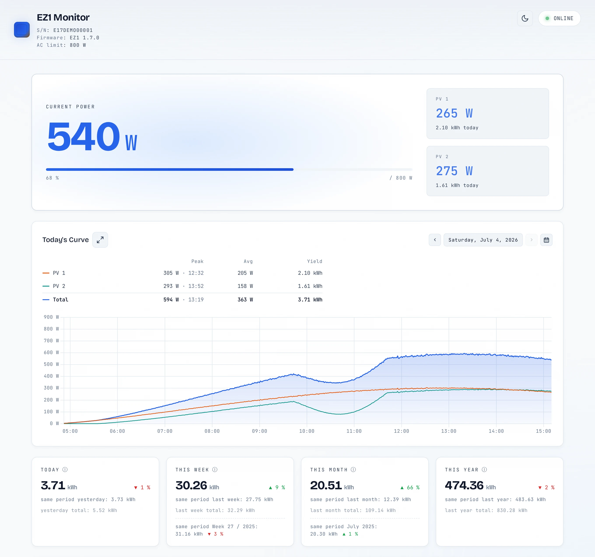
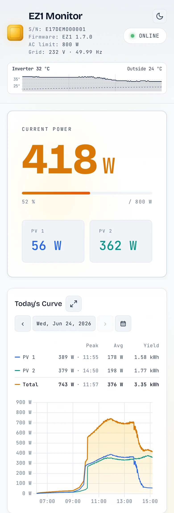
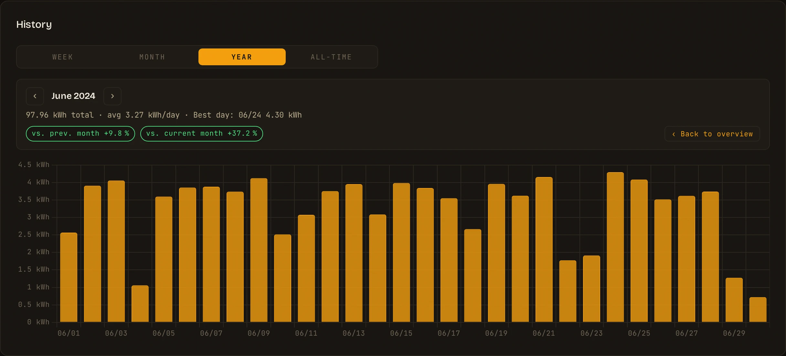
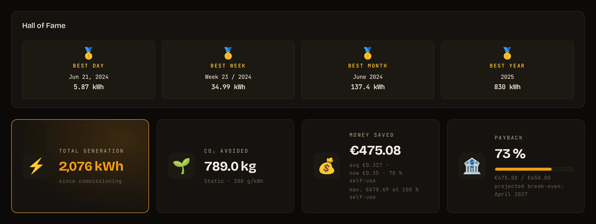
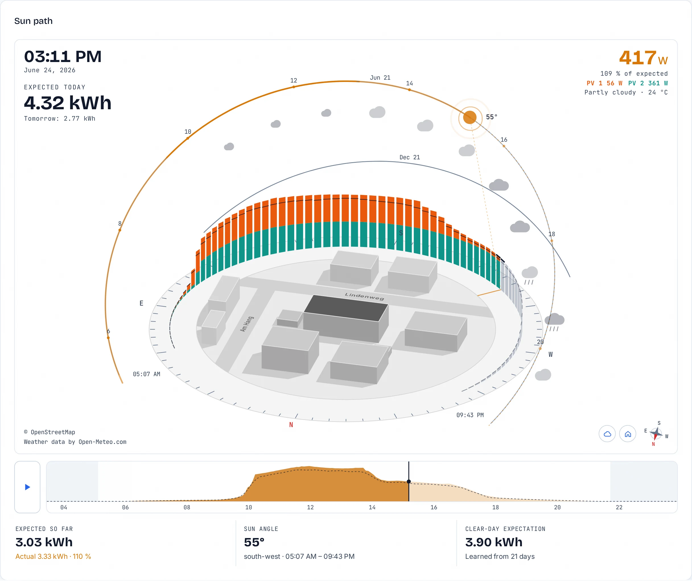
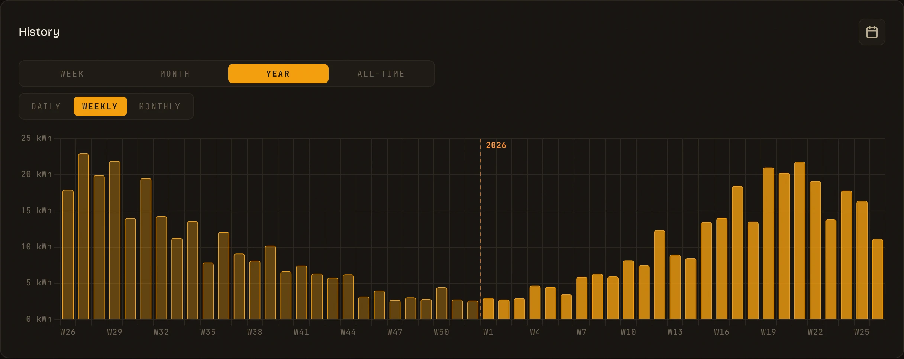
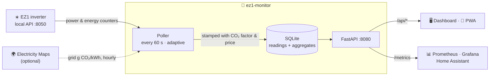

<div align="center">


# EZ1 Monitor

**A lean, self-hosted dashboard for the APsystems EZ1 microinverter family.**
Live power, every day's curve, fair comparisons and long-term records —
straight from the inverter's local API. No cloud, no account, no telemetry.

[](https://github.com/TehcSimon/ez1-monitor/actions/workflows/build-and-push.yml)
[](./LICENSE)
[](https://www.python.org/)
[](https://github.com/TehcSimon/ez1-monitor/pkgs/container/ez1-monitor)
[](#install-paths)
[](#install-paths)

</div>

---

<p align="center">
  <picture>
    <source media="(prefers-color-scheme: dark)" srcset="docs/screenshots/dashboard-dark.webp">
    
  </picture>
  <br><i>Live power, today's curve and calendar-aligned comparisons — <a href="docs/screenshots/full-dark.webp">see the whole dashboard</a>.</i>
</p>

## Why

An EZ1 inverter has a local HTTP API, but on its own it only knows *right now*
and *today*. EZ1 Monitor polls it, keeps every reading in SQLite and turns
them into the dashboard a balcony-plant owner actually wants: how today
compares to yesterday *at the same time*, whether this is a record week,
what the plant has saved so far and when it will have paid for itself.

Everything runs in one small container on your own hardware — a NAS, an
Unraid box, a Raspberry Pi. Nothing leaves your network unless you opt in
to live grid CO₂ data.

## What you get

<picture>
  <source media="(prefers-color-scheme: dark)" srcset="docs/screenshots/mobile-dark.webp">
  
</picture>

- ⚡ **Live view.** Total and per-input power, refreshed every 10 s while the
  sun is up and right away when you come back to the tab, plus grid voltage
  and frequency where the firmware reports them. A small graph in the header
  shows the inverter's temperature over the last three hours, light blue at
  3 °C and below, red from 60 °C, and with `WEATHER_ENABLED` the outside
  temperature as a dashed line.
- 📈 **Every day, browsable.** The day's curve plus a day picker for every
  recorded day in the retention window — or jump there from a history bar.
- 🌤️ **Shading at a glance.** Peak, average and yield per panel and in total
  for the selected day, with each panel as its own line in the curve.
- ⚖️ **Fair comparisons.** Today vs. yesterday until the same clock time;
  week, month and year vs. the same point of the previous period, plus
  year-over-year.
- 🔍 **History drill-down.** Week, month, year (daily · weekly · monthly)
  and all-time. Click a bar to open that week or month with totals, best day
  and comparison pills — including a *record pace* check against your best
  period.
- ☀️ **Sun path.** A rotatable model of the sun's path and the day's yield
  around a reduced map of your house, with what to expect learned from your
  own days, a projection of today's total and, optionally, the weather forecast.
- 🏆 **Hall of Fame.** All-time best day, week, month and year, with a
  subtle glow while a record is fresh.
- 💶 **Savings & payback.** Realistic money saved (self-consumption share,
  feed-in tariff, tariff history) and a payback card with the projected
  break-even month.
- 🌱 **CO₂ avoided.** Static factor or live grid intensity from
  Electricity Maps, stamped onto every reading.
- 🚦 **Smart status.** Tells dusk from a real outage and shrugs off a single
  dropped poll — no false alarms — and polls 10× slower while the inverter
  sleeps.
- 📊 **Prometheus `/metrics`** for Grafana, Home Assistant & co.
- 📱 **PWA, themes, two languages.** Installable on iOS and Android, light
  and dark theme, English and German.
- 🔒 **Self-contained.** All assets self-hosted (no CDN, no Google Fonts),
  non-root and UID-agnostic image for Docker, Kubernetes and OpenShift.

<br clear="right">

### A closer look

<table>
  <tr>
    <td width="50%"></td>
    <td width="50%"></td>
  </tr>
  <tr>
    <td><sub><b>Drill-down.</b> Any week or month as daily bars — compared with the previous period, last year, and whether the running period is on record pace.</sub></td>
    <td><sub><b>Records & lifetime.</b> All-time bests, total energy, CO₂ avoided, realistic savings and payback progress.</sub></td>
  </tr>
  <tr>
    <td colspan="2"><picture><source media="(prefers-color-scheme: dark)" srcset="docs/screenshots/sun-scene-dark.webp"></picture></td>
  </tr>
  <tr>
    <td colspan="2"><sub><b>Sun path.</b> Drag to rotate, scrub or play the day. The compass rose turns the view to a direction, the house button back to the default and plays the day. The map is a made-up street here; with <code>SITE_ADDRESS</code> it is yours.</sub></td>
  </tr>
  <tr>
    <td colspan="2"></td>
  </tr>
  <tr>
    <td colspan="2"><sub><b>The year at a glance.</b> 52 weekly bars across the year boundary — click one to drill into that week.</sub></td>
  </tr>
</table>

<sub>All screenshots show synthetic demo data — see [Development → Screenshots](#screenshots).</sub>

## Supported inverters

Built on an EZ1-M and in use on an EZ1D. The rest of the EZ1 family (EZ1-H,
EZ1-LV, EZ1D-L, EZ1D-H and the single-input EZ1-SPE) should work the same way
through the local API, but hasn't been tried with the monitor yet. If you run
one of them, an [issue](https://github.com/TehcSimon/ez1-monitor/issues) saying
how it went helps everyone.

The family has at most two inputs per inverter, shown as PV 1 and PV 2. Four
panels on an EZ1D are wired in pairs, so each pair shows up as one input.

## Quickstart

**You need** an EZ1 inverter on your network with a fixed IP (DHCP reservation)
and its **local API switched on**: in the AP EasyPower app, set the
inverter's *Local Mode* to **Continuous**. Check that it answers:

```bash
curl http://<EZ1-IP>:8050/getDeviceInfo
```

Then start the monitor:

```bash
docker run -d --name ez1-monitor --restart unless-stopped \
  -p 8080:8080 -v ez1-data:/data \
  -e INVERTER_IP=<EZ1-IP> \
  -e TZ=Europe/Berlin \
  ghcr.io/tehcsimon/ez1-monitor:latest
```

Open `http://<host>:8080`. `INVERTER_IP` is required — the container exits
without it. Set `TZ` to your timezone: it decides where days, weeks and
months begin (the default is UTC).

### Install paths

| | How |
|---|---|
| **Docker** | The command above. Multi-arch image (`amd64`, `arm64`) for NAS, mini PC or Raspberry Pi. |
| **Docker Compose** | Clone the repo, set `INVERTER_IP` and friends in [`docker-compose.yml`](docker-compose.yml), then `docker compose up -d`. |
| **Unraid** | One click: add `https://github.com/TehcSimon/ez1-monitor` under *Apps → Settings → Template Repositories* and install **ez1-monitor** — or set it up by hand, see below. |
| **Kubernetes / OpenShift** | UID-agnostic non-root image, works under OpenShift's restricted SCC. Snippet below. |

<details>
<summary><b>Unraid by hand</b></summary>

1. Docker tab → **Add Container**
2. Repository: `ghcr.io/tehcsimon/ez1-monitor:latest`
3. Network Type: Bridge, Port `8080:8080`
4. Path: `/mnt/user/appdata/ez1-monitor` → `/data`
5. Variables: `INVERTER_IP` = your inverter's IP, `TZ` = your timezone
6. Apply

</details>

<details>
<summary><b>Kubernetes pod snippet</b></summary>

```yaml
spec:
  securityContext:
    runAsNonRoot: true
    fsGroup: 0           # required for /data volume write access
  containers:
    - name: ez1-monitor
      image: ghcr.io/tehcsimon/ez1-monitor:latest
      env:
        - { name: INVERTER_IP, value: "192.168.1.100" }
        - { name: TZ, value: "Europe/Berlin" }
      volumeMounts:
        - { name: data, mountPath: /data }
      ports:
        - { containerPort: 8080 }
      livenessProbe:
        httpGet: { path: /health, port: 8080 }
```

</details>

## How it works



- **Every reading is stamped** with the CO₂ factor and electricity price
  active at that moment. A tariff change only affects new production, and
  with Electricity Maps the cleaner noon grid counts exactly when your
  panels produce.
- **Raw readings are pruned** after `RETENTION_DAYS` (default: two years).
  Daily, monthly and yearly aggregates are kept forever — they feed the
  all-time view, the Hall of Fame and drill-downs into any past week or month.
- **Comparisons are calendar-aligned.** Tuesday 09:30 is compared with last
  Tuesday 09:30, the 12th of a month with the 12th of the previous one —
  never a half day against a full one.

## Configuration

All configuration is done via environment variables.

| Variable | Default | What it does |
|---|---|---|
| `INVERTER_IP` | **required** | IP address or hostname of the inverter |
| `TZ` | `Etc/UTC` | IANA timezone (e.g. `Europe/Berlin`) — where days, weeks and months begin |
| `INVERTER_PORT` | `8050` | Port of the inverter's local API |
| `POLL_INTERVAL` | `60` | Seconds between polls; 10× slower (max. 5 min) while the inverter is offline |
| `PRICE_PER_KWH` | `0.35` | Your electricity price per kWh, stamped on every reading — update it when your [tariff changes](#changing-your-tariff) |
| `CURRENCY` | `EUR` | ISO 4217 code for money formatting (`EUR`, `USD`, `CHF`, …) |
| `SELF_CONSUMPTION_PCT` | `100` | Share (%) of production you use yourself; only affects money and payback |
| `FEED_IN_TARIFF` | `0` | Compensation per fed-in kWh, same currency (often `0` for balcony plants) |
| `INSTALL_COST` | `0` | Total installation cost; `> 0` shows the payback card |
| `LIFETIME_OFFSET_KWH` | `0` | Added to the lifetime total, negative lowers it; rarely needed, see [Savings, payback & CO₂](#savings-payback--co) |
| `CO2_KG_PER_KWH` | `0.38` | Static grid CO₂ factor — the fallback without Electricity Maps |
| `ELECTRICITY_MAPS_TOKEN` | *(empty)* | Enables [live grid intensity](#live-grid-intensity-electricity-maps) |
| `ELECTRICITY_MAPS_ZONE` | `DE` | Zone label for the UI (the actual zone is bound to the token) |
| `SITE_ADDRESS` | *(empty)* | Your address or `lat,lon`; enables the sun path and map of the [sun path](#sun-path) |
| `SITE_FLOORS` | *(empty)* | Storeys of your building, for its height and shadow where OpenStreetMap has none |
| `WEATHER_ENABLED` | `false` | `true` adds an hourly forecast from Open-Meteo at `SITE_ADDRESS` to the [sun path](#sun-path) |
| `RETENTION_DAYS` | `730` | Days of raw readings to keep (`0` = forever); aggregates are always kept |
| `DEFAULT_LANG` | *(empty)* | Force `de` or `en`; empty = browser language |
| `DB_PATH` | `/data/ez1.db` | SQLite database file |
| `LOG_LEVEL` | `INFO` | Python log level (`DEBUG`, `INFO`, `WARNING`) |

> **Security note:** there is no built-in authentication. Run it on a
> trusted LAN, or put it behind a reverse proxy with auth before exposing
> it publicly.

## Status indicator

| Indicator | Meaning |
|---|---|
| 🟢 **online** (pulsing) | The inverter responds, everything is fine |
| ⚪ **standby** (dim) | Offline, but production had already wound down (dusk, night, snow) — no alarm |
| 🔴 **error** (pulsing) | Went offline mid-production — a real alarm |
| ⚪ **no data** | Just started, no successful poll yet |
| 🟠 **connection error** | The dashboard can't reach its own backend (network blip, container restarting) — says nothing about the inverter |

Standby vs. error is decided by how production looked when the inverter
went quiet: an average below ~5 W over its last five minutes online is a
graceful wind-down, anything above is an outage — and stays red until the
inverter answers again. A single dropped poll is neither: the inverter only
counts as offline after three failed polls in a row.

## Savings, payback & CO₂

**Total generation** is the inverter's own lifetime counter, including what
it produced before the monitor was set up. Click the card to see only what
the monitor recorded itself, which is what the history bars add up to; days
the monitor wasn't running are missing from it. Money, CO₂ and payback always
build on the inverter's counter.

Some firmware wraps each input's lifetime counter to 0 near 540 kWh. The
monitor notices that and carries on from the old level. `LIFETIME_OFFSET_KWH`
is only for what it can't know: a wrap from before it was set up (enter the
level the counter wrapped at, e.g. `540`), or a manual correction (negative
values lower the total). Don't enter a wrap the monitor saw itself, that would
count it twice.

**Money saved** values every kWh at the price stamped on its reading.
Production without a stamp, from before the monitor was set up, counts at
the oldest stamped price. Without a battery you won't use all of it yourself:
`SELF_CONSUMPTION_PCT` scales the savings to the share you consume, the
fed-in rest earns `FEED_IN_TARIFF`. With a share below 100 %, the card shows
the realistic figure and, below it, the ceiling at full self-consumption.

**Payback** (with `INSTALL_COST` set) shows how much of the installation
has been earned back and highlights the break-even. Once a full year of
data exists — shorter histories are skewed by the season — it also
projects the month the installation will have paid for itself, from your
average production so far at the current tariff.

**CO₂ avoided** uses the static `CO2_KG_PER_KWH` by default. That is a
yearly average and tends to overstate it, because solar panels produce
precisely when the grid is cleanest.

### Changing your tariff

Update `PRICE_PER_KWH` and recreate the container, ideally the evening before
the switch: nothing is produced overnight, so every kWh ends up at the right
price. What has already been produced keeps its value. From then on the money
card shows both prices ("avg €0.334 · now €0.28"), and the payback projection
uses the new one.

`SELF_CONSUMPTION_PCT` and `FEED_IN_TARIFF` work differently: they apply to
the whole history, so changing them moves the money card right away.

### Live grid intensity (Electricity Maps)

With a token, the container fetches your grid's live carbon intensity once
an hour and stamps it onto every reading, so the lifetime CO₂ figure
reflects the grid as it was when your panels produced.

1. Sign up at <https://www.electricitymaps.com/free-tier-api> and choose
   the **Home Assistant** path — the free tier with permanent API access
   (the key works with any HTTP client).
2. Select your grid zone (e.g. `DE`). It is **locked for 30 days**, so pick
   carefully.
3. Set `ELECTRICITY_MAPS_TOKEN=<your key>` (and `ELECTRICITY_MAPS_ZONE=DE`
   for the UI label — the real zone is bound to the token).

<details>
<summary><b>Fallback cascade</b> — what the CO₂ card shows when the API is unavailable</summary>

| Time since the last successful poll | Source | UI label |
|---|---|---|
| 0 – 6 h | `live` | "Live (DE) · 117 g/kWh · 22:00" |
| 6 – 48 h | `stale` | "Last value (DE) · 117 g/kWh · 12 h ago" |
| > 48 h | `avg` | "Average (DE) · 248 g/kWh · over N polls" |
| no token / no data ever | `static` | "Static · 380 g/kWh" |

The average is built from every successful poll since the container
started. Failed polls are retried with backoff (5 → 40 min). The container
calls `GET https://api.electricitymap.org/v3/home-assistant` with your
token — 1 request per hour against a limit of 50.

</details>

## Sun path

The card below the period tiles follows the day picked in the day chart.

**Expected vs. actual and today's projection** need nothing but your own
history: the expectation is what clear days have recently delivered at each time of
day (the 90th percentile of the last three weeks, from 7 recorded days on), so
it needs no module data and already contains recurring shading such as a
privacy screen. The projection extrapolates the rest of the day from how today
compares to the expectation so far, once 10 % of the expected energy is in.

**The weather forecast** is optional: set `WEATHER_ENABLED=true` in addition to
`SITE_ADDRESS`. The same three weeks then also teach how much your plant
delivers per W/m² of forecast radiation at each time of day. That turns the
forecast into a curve for the rest of today, a projection from the start of the
day and an estimate for tomorrow. The earlier it is, the more the forecast
counts against how the day has gone so far; from midday on they count half
each. Without a recent forecast the card falls back to your own history.
The scene also draws each hour's weather along the sun's path: clouds, rain,
snow, a thunderstorm, and a veil of fog over the map. The cloud button next to
the compass rose hides it.

Tested on 139 days of one plant from June to November, each day estimated only
from the days before it and with the forecast as it was published a day
earlier:

| Median error of the day's total | Before sunrise | After 10 % | 25 % | 50 % | 75 % of a clear day's energy |
|---|---|---|---|---|---|
| History only | – | 28 % | 16 % | 8 % | 4 % |
| With forecast | 16 % | 14 % | 12 % | 7 % | 4 % |

The forecast helps most in the morning and on changeable days; from midday on
the two are about equal. For tomorrow the median error is 16 %, and one day in
ten is off by more than 56 % (123 % for the average of the last three weeks).

**Sun path and map** are optional and need `SITE_ADDRESS`. The address is
either a normal postal address or `lat,lon`, which skips the address search.

These two settings are the only ones that send something about where you live
to an outside service, so both are off unless you set them. Once, and again
only when the value changes, the server sends the address to
[Nominatim](https://nominatim.openstreetmap.org/) and the surrounding
coordinates to the [OpenStreetMap API](https://www.openstreetmap.org/), or to
Overpass if that fails. The result is kept in `site-map.json` next to the
database. With `WEATHER_ENABLED` it also asks
[Open-Meteo](https://open-meteo.com/) once an hour for the forecast at your
coordinates rounded to two decimals, about 1 km, and keeps the answer in
`weather.json`. The browser never talks to any of them, and neither the address
nor the coordinates are logged. The address isn't written to those files
either. As with everything else on the dashboard, anyone who can open it can
see the map, so mind that before exposing it beyond your LAN.

The map shows a fixed 50 m around your building. Heights come from
OpenStreetMap, where most buildings have none and are estimated from their
type; `SITE_FLOORS` sets your own. Map data © OpenStreetMap contributors,
available under the [ODbL](https://www.openstreetmap.org/copyright). Weather
data by [Open-Meteo.com](https://open-meteo.com/) under
[CC BY 4.0](https://creativecommons.org/licenses/by/4.0/), free for
non-commercial use and without an API key.

## API & metrics

All endpoints return JSON except `/metrics`. Like the dashboard, they're
unauthenticated — meant for the LAN.

<details>
<summary><b>REST endpoints</b></summary>

| Endpoint | Description |
|---|---|
| `GET /health` | Health check: `503` if the poller has stalled, never because the inverter sleeps |
| `GET /api/live` | Latest measurement + device info + status + runtime config |
| `GET /api/history?range=day\|week\|month\|year` | Historical data points |
| `GET /api/history?range=day&date=YYYY-MM-DD` | A specific day's intraday curve and per-panel figures |
| `GET /api/history?range=year&granularity=monthly\|weekly` | Year view aggregated by month or ISO week |
| `GET /api/history?range=week&week=YYYY-Www` | A specific ISO week (daily bars + summary) |
| `GET /api/history?range=month&month=YYYY-MM` | A specific month (daily bars + summary) |
| `GET /api/history?range=multiyear&granularity=monthly\|yearly` | All years |
| `GET /api/yield-curve?date=YYYY-MM-DD` | A day in 5-minute slots with learned expectation, today's projection, forecast and hourly weather |
| `GET /api/site` | Location and map cut-out for the sun path card |
| `GET /api/temperatures` | Inverter temperature of the last three hours, plus the outside temperature with `WEATHER_ENABLED` |
| `GET /api/stats` | Aggregated statistics with same-period and YoY comparisons |
| `GET /api/highscores` | All-time best day/week/month/year with animation state |
| `GET /api/aggregates` | Long-term yearly aggregates (survive retention) |
| `GET /api/aggregates?year=YYYY` | Monthly aggregates for a specific year |
| `GET /metrics` | Prometheus exposition format |

</details>

<details>
<summary><b>Prometheus metrics</b></summary>

```
ez1_current_power_watts
ez1_pv1_power_watts, ez1_pv2_power_watts
ez1_today_kwh, ez1_pv1_today_kwh, ez1_pv2_today_kwh
ez1_this_week_kwh, ez1_this_month_kwh, ez1_this_year_kwh
ez1_peak_today_watts
ez1_lifetime_kwh_total
ez1_co2_saved_kg_total
ez1_money_saved
ez1_amortization_percent
ez1_carbon_intensity_g_per_kwh
ez1_carbon_fossil_percentage
ez1_carbon_source{source="live|stale|avg|static"}
ez1_status{state="online|standby|error|noData"}
ez1_info{device_id="...", firmware="...", version="..."}
```

</details>

## Data & backups

A single SQLite file (`/data/ez1.db`, WAL mode). With normal day/night
cycles and 60 s polling, expect about 20 MB per year. To back it up, copy
the file — safe while the container is running. The Unraid appdata backup
plugin handles this automatically.

## Upgrading

Pull the new image and recreate the container — schema changes migrate
automatically on startup. Version-by-version notes are in
**[UPGRADING.md](UPGRADING.md)**.

## Troubleshooting

**The container exits right away** — check `docker logs ez1-monitor`. The
most common cause is a missing or malformed `INVERTER_IP`.

**The status stays "no data" or "error"** — make sure the inverter answers
(`curl http://<EZ1-IP>:8050/getDeviceInfo`) and that *Local Mode* is set to
**Continuous** in the AP EasyPower app.

**Start over with an empty database** — stop the container, delete
`ez1.db` (plus `ez1.db-wal` and `ez1.db-shm`) from the data volume, start
it again.

## Development

```bash
git clone https://github.com/TehcSimon/ez1-monitor.git
cd ez1-monitor

# Tests: pure helpers + async integration tests on a temporary SQLite DB
pip install -r requirements-dev.txt
pytest

# Build and run the image
docker build -t ez1-monitor:local .
docker run --rm -p 8080:8080 -e INVERTER_IP=<your-ip> ez1-monitor:local
```

CI runs the test suite on every pull request and before every image build;
pushes to `main` publish multi-arch images (`linux/amd64`, `linux/arm64`)
to GHCR.

### Screenshots

The screenshots in this README come from the real image running against
synthetic data: a deterministic demo plant, a fake EZ1-M API and a pinned
clock, captured with Playwright. To regenerate them into `docs/screenshots/`
after a UI change:

```bash
tools/screenshots/run.sh
```

### Repo layout

```
ez1-monitor/
├── app/
│   ├── main.py            # FastAPI app: config, endpoints, background tasks, /metrics
│   ├── poller.py          # inverter polling, adaptive interval, offline markers
│   ├── database.py        # SQLite schema, migrations, aggregates, all queries
│   ├── co2.py             # Electricity Maps client + live/stale/avg/static resolver
│   ├── site_map.py        # optional location: address lookup, OSM cut-out, cache
│   ├── weather.py         # optional hourly forecast from Open-Meteo, cached
│   ├── yield_curve.py     # learned target, today's projection, forecast response (pure)
│   ├── money.py           # savings and payback model (pure)
│   ├── lifetime.py        # lifetime counters across a counter reset (pure)
│   ├── date_helpers.py    # calendar and ISO-week math (pure)
│   └── static/            # dashboard: index.html, app.js, sun-scene.js, i18n.js, style.css, vendored libs
├── tests/                 # pytest suites
├── tools/
│   ├── generate_mock_db.py   # mock database for testing the Hall-of-Fame glow
│   └── screenshots/          # demo data, fake inverter, Playwright → docs/screenshots/
├── docs/screenshots/      # README images
├── .unraid/               # Unraid template and icon
├── Dockerfile             # multi-stage Alpine build, non-root, UID-agnostic
├── docker-compose.yml
└── UPGRADING.md           # release history and upgrade notes
```

## Acknowledgements

Built on the shoulders of
[apsystems-ez1](https://pypi.org/project/apsystems-ez1/) (Sonnenladen GmbH),
[FastAPI](https://fastapi.tiangolo.com/),
[Chart.js](https://www.chartjs.org/),
[flatpickr](https://flatpickr.js.org/),
[Electricity Maps](https://www.electricitymaps.com/),
[OpenStreetMap](https://www.openstreetmap.org/copyright) and
[Open-Meteo](https://open-meteo.com/).

## License

[MIT](./LICENSE). Built for personal use with the APsystems EZ1-M — not
affiliated with APsystems.
